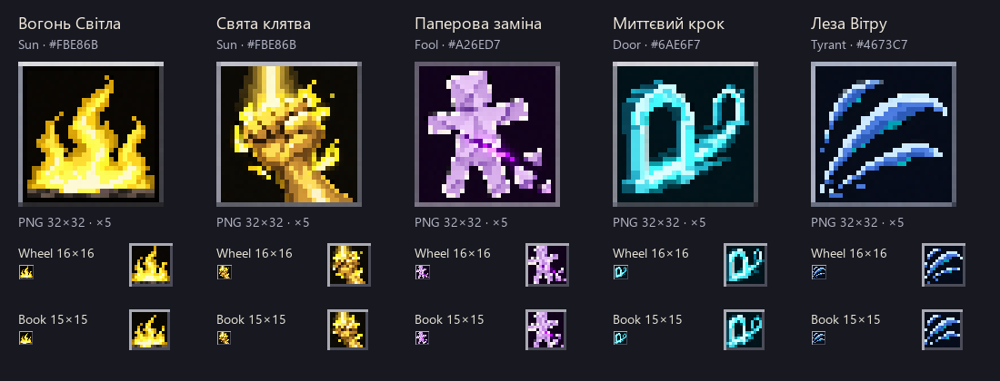

# Mysteries Above — тестова серія іконок v1

Перший етап для оцінки стилю: **5 готових іконок, 4 Pathways**. Після схвалення стилю створено повні набори [Fool — 18 іконок](fool/README.md), [Door — 14 іконок](door/README.md), [Sun — 18 іконок](sun/README.md), [Justiciar — 16 іконок](justiciar/README.md), [Death — 20 іконок](death/README.md), [Error — 19 іконок](error/README.md), [Tyrant — 31 іконка](tyrant/README.md) та [WhiteTower — 10 іконок](whitetower/README.md).

**Оновлення розмірів UI:** готові іконки збільшені до 24×24 у колесі, списках книги та обох HUD; вибрана іконка в книзі — 32×32. [Порівняння до/після та поточні ігрові знімки](larger-ui/README.md).

## Художня система

- Окремий квадратний PNG 32×32 для кожної здібності; чіткі піксельні кластери, без тексту та чисел.
- Темне внутрішнє поле з відтінком Pathway, великий читабельний силует і локальні світлі осередки магії.
- Базова палітра з [`PathwayBranding.liquid`](../../core/src/main/kotlin/me/vangoo/domain/PathwayBranding.kt). Сусідні темні відтінки для об'єму, світлі для магічного ядра. Legacy-колір тексту — лише допоміжний акцент.
- Спільна тонка металева рамка. UI додає однаковий кант завтовшки один GUI-піксель: зменшення самого PNG до 15–16 пікселів інакше втрачало частину рамки.
- Здібність визначає предмет і композицію; Pathway визначає палітру. Два Sun-зразки навмисно мають зовсім різні силуети.

## Готові зразки

| Здібність | Pathway / RGB | Образ із поточної реалізації | PNG для UI | Джерело у великому розмірі |
|---|---|---|---|---|
| Вогонь Світла | Sun `#FBE86B` | Стаціонарне святе полум'я на землі, яке утримує ділянку | [32×32](../../mod/src/client/resources/assets/mysteries_above/textures/gui/sprites/ability/sun_fire_of_light.png) | [PNG](source/sun_fire_of_light.png) |
| Свята клятва | Sun `#FBE86B` | Палаючий кулак під сонячним променем: посилені удари та відкрита видимість | [32×32](../../mod/src/client/resources/assets/mysteries_above/textures/gui/sprites/ability/sun_holy_oath.png) | [PNG](source/sun_holy_oath.png) |
| Заміна паперовою лялькою | Fool `#A26ED7` | Паперова фігурка приймає удар і розпадається на клаптики | [32×32](../../mod/src/client/resources/assets/mysteries_above/textures/gui/sprites/ability/fool_paper_substitution.png) | [PNG](source/fool_paper_substitution.png) |
| Миттєвий крок | Door `#6AE6F7` | Два дверні отвори й короткий просторовий прохід між ними | [32×32](../../mod/src/client/resources/assets/mysteries_above/textures/gui/sprites/ability/door_blink.png) | [PNG](source/door_blink.png) |
| Леза Вітру | Tyrant `#4673C7` | Віяло з трьох різальних повітряних поривів | [32×32](../../mod/src/client/resources/assets/mysteries_above/textures/gui/sprites/ability/tyrant_windblades.png) | [PNG](source/tyrant_windblades.png) |

Згенеровано вбудованим **image_gen**, по одному зображенню на здібність. Повні промпти: [prompts.json](prompts.json). Великі результати збережені окремо в `source/`; UI-версії зменшені nearest-neighbor до 32×32. `preview.png` — лише огляд для оцінки, він не використовується як атлас.

## Досліджений обсяг

[Каталог концепцій](CATALOG.md) містить **156 унікальних identity**, **163 входження в Pathways** та всі **22 палітри** з коду. Дев'ять Pathways мають здібності, тринадцять — лише заготовки. Для кожної здібності є короткий образ і посилання на її реалізацію. Машинний список: [concepts.tsv](concepts.tsv).

Повторювані identity у різних Послідовностях означають розвиток однієї сили. Спільні здібності й динамічні `door_recorded_*` вимагають окремого врахування палітри та джерела під час наступного етапу; тестові п'ять не мають цієї неоднозначності.

## Інтеграція й перевірка

Іконки підключені через наявний GUI sprite atlas, без власного завантажувача, нових залежностей або змін мережевого протоколу. Наявний `BookAbilityIcons` обслуговує книгу, колесо, його картку перемикання та обидва HUD. Для решти здібностей поки працюють попередні іконки. Механіка здібностей не змінена.

Перевірено:

- `./gradlew.bat :mod:test --tests me.vangoo.mysteries.client.render.BookArtTest` — окремі PNG, розмір 32×32, унікальність зображень, відповідність зареєстрованим здібностям і наявні перевірки книжкового оформлення.
- `./gradlew.bat :mod:runClientGameTest -Ponly=Icons` — реальний клієнт Minecraft 26.2, OpenGL; усі п'ять зразків у Ability Wheel і деталях Ability Book. Скриншоти 854×480, масштаб GUI 2: 16×16 GUI-пікселів у колесі й 15×15 у книзі.
- Каталог зіставлено з усіма explicit identity старого набору піктограм, шістьма концептуальними крадіжками та фабриками дев'яти реалізованих Pathways: 156 записів, без пропусків і дублікатів.

Ігрові приклади: [Sun у колесі](in-game/0002_icons-wheel-sun_fire_of_light.png), [Fool у колесі](in-game/0004_icons-wheel-fool_paper_substitution.png), [Door у книзі](in-game/0007_icons-book-door_blink.png), [Tyrant у колесі](in-game/0008_icons-wheel-tyrant_windblades.png). У `in-game/` збережені всі десять скриншотів.

У малому UI читаються головні силуети; дрібна анатомія кулака й складки паперу природно спрощуються. GUI 3+, Vulkan, повний набір і варіанти спільних/записаних сил цим етапом не перевірялись. Перед масштабуванням потрібна художня оцінка п'яти зразків, особливо щільності деталей і товщини рамки.
