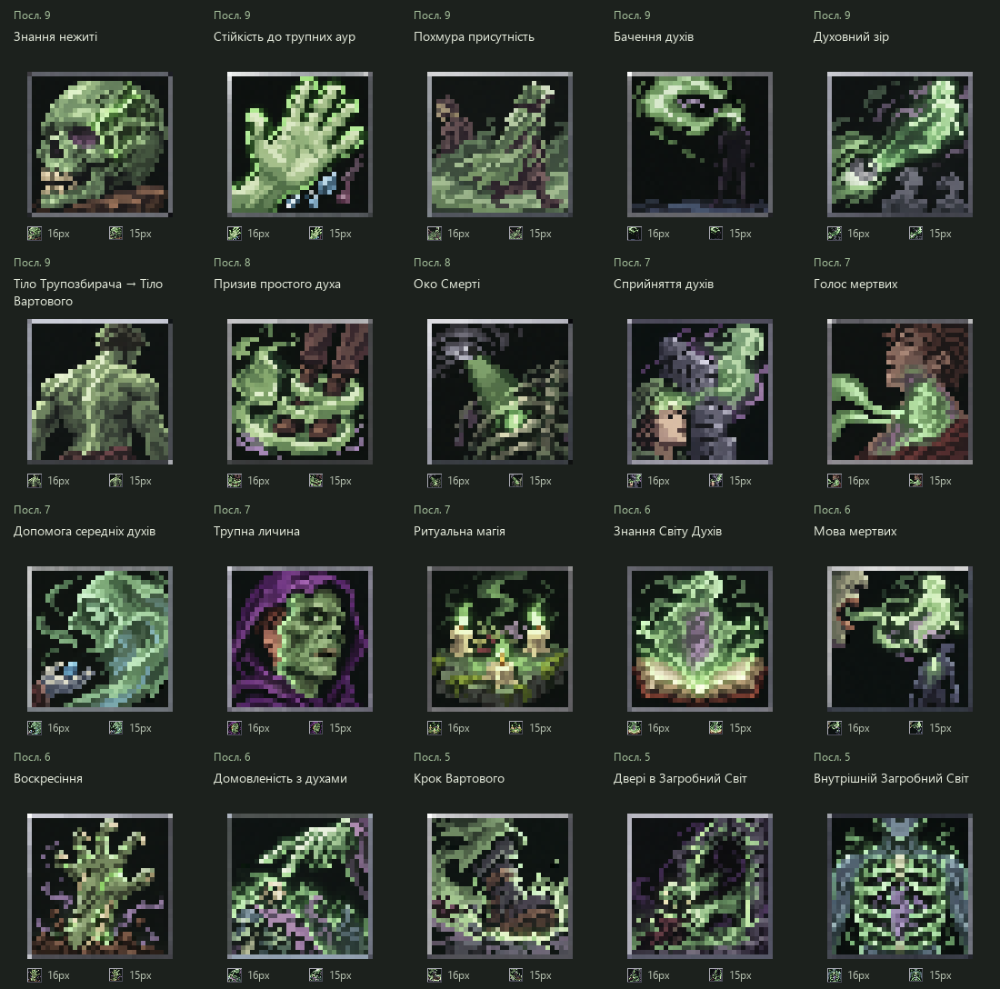

# Death — повний набір іконок

**20 окремих PNG** для всіх унікальних здібностей шляху Смерті в Послідовностях 9–5. Концепції спираються на актуальну реалізацію: сприйняття духовних тіл, взаємодію з духами, підняття мерців і сили Вартового.

Основна палітра — **#728F6C** (`114, 143, 108`) з `PathwayBranding.liquidOf("Death")`: приглушений мохово-зелений, світлі шавлієві площини та блідо-зелені осередки. Для читабельності світло яскравіше за базовий RGB. Додаткові кольори залежать від здібності: старий кістяний відтінок, бузкові духовні тіні, сланцево-блакитний мороз, темна могильна земля, бордові матеріальні акценти. Зелений лишається головним кольором магії.

Чіткі піксельні кластери, темне поле, великий силует і тонка спільна срібляста рамка продовжують стиль Fool, Door, Sun та Justiciar. Сили сприйняття мають різні образи: димок прихованої душі, відкрите око й духовний контраст, безбарвний погляд на вразливий вузол, заплющені очі та відбиток за стіною.

Створено вбудованим **image_gen**, окремим викликом для кожної іконки. [Повні промпти](prompts.json), [список файлів і концепцій](manifest.json). Після перевірки малого розміру для «Дверей у Загробний Світ» уточнено товщину зовнішньої рамки: [промпт редагування](refinements.json), попередній великий варіант — у `previous/source/`. Великі джерела збережені в `source/`, PNG для мода зменшено nearest-neighbor до 32×32. [Огляд при 15×15 та 16×16](ui-sizes.png).

## Файли та концепції

| Посл. | Здібність | Образ | PNG 32×32 |
|---|---|---|---|
| 9 | Знання нежиті | Череп у розрізі з виразно підсвіченою вразливою тріщиною. | [death_undead_knowledge.png](../../../mod/src/client/resources/assets/mysteries_above/textures/gui/sprites/ability/death_undead_knowledge.png) |
| 9 | Стійкість до трупних аур | Холодна долоня лишається неушкодженою під морозом і краплями тліну. | [death_cadaveric_resilience.png](../../../mod/src/client/resources/assets/mysteries_above/textures/gui/sprites/ability/death_cadaveric_resilience.png) |
| 9 | Похмура присутність | Холодний спокійний силует проходить поруч із нежиттю, яка відвертається. | [death_gloomy_presence.png](../../../mod/src/client/resources/assets/mysteries_above/textures/gui/sprites/ability/death_gloomy_presence.png) |
| 9 | Бачення духів | Прихована темна постать видає себе густим світлим димком душі. | [death_death_sight.png](../../../mod/src/client/resources/assets/mysteries_above/textures/gui/sprites/ability/death_death_sight.png) |
| 9 | Духовний зір | Відкрите око бачить зелену душу серед сірих тіл. | [death_spirit_vision.png](../../../mod/src/client/resources/assets/mysteries_above/textures/gui/sprites/ability/death_spirit_vision.png) |
| 9 | Тіло Трупозбирача → Тіло Вартового | Міцні плечі зі спини та холодне світло вздовж хребта. | [death_physique.png](../../../mod/src/client/resources/assets/mysteries_above/textures/gui/sprites/ability/death_physique.png) |
| 8 | Призив простого духа | Один дух обвиває щиколотки цілі й міцно їх утримує. | [death_spirit_communication.png](../../../mod/src/client/resources/assets/mysteries_above/textures/gui/sprites/ability/death_spirit_communication.png) |
| 8 | Око Смерті | Безбарвне око згори відкриває один уразливий вузол у ребрах цілі. | [death_eye_of_death.png](../../../mod/src/client/resources/assets/mysteries_above/textures/gui/sprites/ability/death_eye_of_death.png) |
| 7 | Сприйняття духів | Заплющені очі й духовний відбиток за кам’яною перешкодою. | [death_spirit_perception.png](../../../mod/src/client/resources/assets/mysteries_above/textures/gui/sprites/ability/death_spirit_perception.png) |
| 7 | Голос мертвих | Менший духовний профіль відповідає зсередини грудей живої людини. | [death_voice_of_the_dead.png](../../../mod/src/client/resources/assets/mysteries_above/textures/gui/sprites/ability/death_voice_of_the_dead.png) |
| 7 | Допомога середніх духів | Долоня підносить крижане приношення одному морозному духові-помічнику. | [death_spirit_channeling.png](../../../mod/src/client/resources/assets/mysteries_above/textures/gui/sprites/ability/death_spirit_channeling.png) |
| 7 | Трупна личина | Людський профіль ховається під виразною зеленою оболонкою зомбі. | [death_corpse_guise.png](../../../mod/src/client/resources/assets/mysteries_above/textures/gui/sprites/ability/death_corpse_guise.png) |
| 7 | Ритуальна магія | Низький кам’яний вівтар, три свічки та матеріальне приношення в зеленому світлі. | [death_ritual_magic.png](../../../mod/src/client/resources/assets/mysteries_above/textures/gui/sprites/ability/death_ritual_magic.png) |
| 6 | Знання Світу Духів | Над чистими сторінками розкритої книги проявляється будова духа. | [death_spirit_world_knowledge.png](../../../mod/src/client/resources/assets/mysteries_above/textures/gui/sprites/ability/death_spirit_world_knowledge.png) |
| 6 | Мова мертвих | Вимовлена сила відокремлює душу від тіла, залишаючи коротку духовну прив’язь. | [death_language_of_the_dead.png](../../../mod/src/client/resources/assets/mysteries_above/textures/gui/sprites/ability/death_language_of_the_dead.png) |
| 6 | Воскресіння | Мертва кисть і передпліччя підіймаються з могильної землі. | [death_resurrection.png](../../../mod/src/client/resources/assets/mysteries_above/textures/gui/sprites/ability/death_resurrection.png) |
| 6 | Домовленість з духами | Владна долоня спрямовує впорядкований почет нежиті й духів. | [death_spirit_pact.png](../../../mod/src/client/resources/assets/mysteries_above/textures/gui/sprites/ability/death_spirit_pact.png) |
| 5 | Крок Вартового | Важкий крок із зеленою хвилею руху розколює землю при приземленні. | [death_gatekeeper_step.png](../../../mod/src/client/resources/assets/mysteries_above/textures/gui/sprites/ability/death_gatekeeper_step.png) |
| 5 | Двері в Загробний Світ | Темна брама й примарні руки затягують душу через поріг. | [death_door_to_the_underworld.png](../../../mod/src/client/resources/assets/mysteries_above/textures/gui/sprites/ability/death_door_to_the_underworld.png) |
| 5 | Внутрішній Загробний Світ | Грудна клітка утворює темну камеру з одним замкненим духом. | [death_internal_underworld.png](../../../mod/src/client/resources/assets/mysteries_above/textures/gui/sprites/ability/death_internal_underworld.png) |

«Тіло Трупозбирача», «Тіло Могильника», «Тіло Медіума», «Тіло Провідника» та «Тіло Вартового» використовують одну identity `death_physique` і одну іконку розвитку тієї самої сили. Саме тому 24 входження здібностей у Послідовностях дають 20 окремих зображень.

Для багаторежимних сил використано один виразний образ: морозний дух над крижаним приношенням для «Допомоги середніх духів», затягування через поріг для «Дверей у Загробний Світ», дух у грудній клітці для всіх мешканців «Внутрішнього Загробного Світу». «Домовленість з духами» передає і почет, і його підкорення наказу.

«Голос мертвих» показує відповідь духа всередині живої людини відповідно до поточної реалізації. «Мова мертвих» показує душу вже поза тілом на короткій прив’язі. «Воскресіння» піднімає існуючий труп як слугу, а не повертає гравця до життя.

## Інтеграція

Використано наявний GUI sprite atlas та `BookAbilityIcons`: книгу, колесо, картку перемикання й обидва HUD. Ритуальна магія (`common_ritual_magic`) отримала окремий зелений PNG, який вибирається лише для Death; фіолетовий Fool і золотий Sun збережені. Механіки, режими, ідентифікатори здібностей і мережевий протокол не змінені. Нових завантажувачів або залежностей немає.

Спільна рамка має товщину один GUI-піксель у книзі (15×15) та колесі (16×16). Оглядові зображення не використовуються модом як атлас.

## Перевірка

`./gradlew.bat :mod:test --tests me.vangoo.mysteries.client.render.BookArtTest :mod:runClientGameTest -Ponly=Icons`

17.11.2026 успішно завершились **10/10 юніт-тестів та клієнтський ігровий тест**. Перевірено реєстрацію, розмір 32×32, унікальність PNG, покриття Death 20/20 і три окремі ритуальні варіанти Death, Fool та Sun. Для інших Pathways зелена ритуальна іконка не підставляється. Ігровий тест також повторно пройшов Justiciar, Sun, Fool, Door і зразок Tyrant.

У реальному Minecraft 26.2 (OpenGL, GUI 2, 854×480) переглянуто всі 20 іконок у книзі й колесі. Збережено 20 знімків книги та 20 колеса в `in-game/`: [перша сторінка колеса](in-game/wheel-death_undead_knowledge.png), [друга сторінка](in-game/wheel-death_door_to_the_underworld.png), [зелена ритуальна магія в книзі](in-game/book-common_ritual_magic.png), [усі іконки в деталях книги](book-details.png).

Написи поряд зі спрайтами належать UI; самі іконки не містять тексту. GUI 3+ та Vulkan цим запуском не перевірялись.

