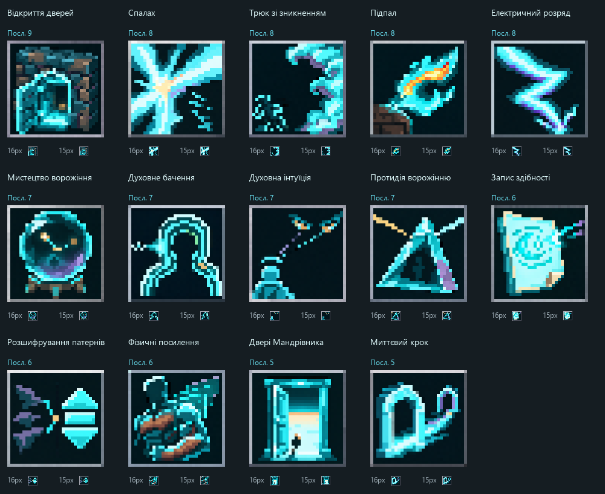

# Door — повний набір іконок

**Колірна версія 2: 14 окремих PNG** для всіх наявних здібностей Door у Послідовностях 9–5. Усі іконки, включно з «Миттєвим кроком», відредаговані вбудованим `image_gen`: композиції та силуети збережені, палітри доповнені кольорами матеріалів і конкретних магічних ефектів.

Головна палітра — **#6AE6F7** з `PathwayBranding.liquidOf("Door")`: світла бірюза, крижані осередки магії, темні бірюзові тіні. Бірюза залишається найпомітнішим кольором; додаткові відтінки відповідають здібності:

- Підпал — жовто-біле гаряче ядро, помаранчевий жар і маленький червоний осередок усередині бірюзового полум'я.
- Електричний розряд — фіолетові краї й вузли під біло-бірюзовим основним розрядом.
- Ворожіння — золоті зоряні точки, аметистові грані кришталю, стриманий бронзовий матеріал підставки.
- Духовне бачення — нефритовий відтінок життєвої аури; інтуїція — бурштинові очі чужої уваги; протидія ворожінню — золотий вхідний промінь і лавандова грань призми.
- Камінь, папір і шкіра — теплі природні відтінки під основним бірюзовим освітленням.
- Просторові проходи — тепла перламутрова далечінь і лавандова глибина, з бірюзовими дверними контурами.

Кожна здібність зберігає власну композицію. Три просторові сили відрізняються призначенням і зображенням: прохід крізь мур, двері в білу рівнину Світу Духів і два отвори швидкого просторового кроку.

Великі результати версії 2 — у `source-v2/`. Робочі PNG 32×32 зменшено nearest-neighbor; вони використовують наявний GUI sprite atlas. [Промпти редагування](prompts-v2.json), [список файлів](manifest.json), [огляд 15×15 та 16×16](ui-sizes.png), [порівняння кожної іконки до/після](comparison-v1-v2.png).

Попередні PNG 32×32 та огляди збережені у `v1/`: [старий набір](v1/preview.png), [його список файлів](v1/manifest.json). Початкові великі зображення також залишені у `source/` та [`../source/door_blink.png`](../source/door_blink.png).

«Підпал» має окремі версію Door з бірюзовим полум'ям і гарячим ядром та вже готову фіолетову Fool. «Протидія ворожінню» також є в Justiciar: її бірюзова версія вибирається лише для Door, а Justiciar тепер має [власний повний набір](../justiciar/README.md) з окремою тепло-золотою завісою. Рендерер, механіка здібностей, identity та мережевий протокол цим колірним редагуванням не змінювались.

## Файли

| Посл. | Здібність | PNG 32×32 |
|---|---|---|
| 9 | Відкриття дверей | [door_opening.png](../../../mod/src/client/resources/assets/mysteries_above/textures/gui/sprites/ability/door_opening.png) |
| 8 | Спалах | [door_flash.png](../../../mod/src/client/resources/assets/mysteries_above/textures/gui/sprites/ability/door_flash.png) |
| 8 | Трюк зі зникненням | [door_escape_trick.png](../../../mod/src/client/resources/assets/mysteries_above/textures/gui/sprites/ability/door_escape_trick.png) |
| 8 | Підпал | [door_burning.png](../../../mod/src/client/resources/assets/mysteries_above/textures/gui/sprites/ability/door_burning.png) |
| 8 | Електричний розряд | [door_electric_shock.png](../../../mod/src/client/resources/assets/mysteries_above/textures/gui/sprites/ability/door_electric_shock.png) |
| 7 | Мистецтво ворожіння | [door_divination_arts.png](../../../mod/src/client/resources/assets/mysteries_above/textures/gui/sprites/ability/door_divination_arts.png) |
| 7 | Духовне бачення | [door_spiritual_vision.png](../../../mod/src/client/resources/assets/mysteries_above/textures/gui/sprites/ability/door_spiritual_vision.png) |
| 7 | Духовна інтуїція | [door_spiritual_intuition.png](../../../mod/src/client/resources/assets/mysteries_above/textures/gui/sprites/ability/door_spiritual_intuition.png) |
| 7 | Протидія ворожінню | [door_anti_divination.png](../../../mod/src/client/resources/assets/mysteries_above/textures/gui/sprites/ability/door_anti_divination.png) |
| 6 | Запис здібності | [door_record.png](../../../mod/src/client/resources/assets/mysteries_above/textures/gui/sprites/ability/door_record.png) |
| 6 | Розшифрування патернів | [door_decrypt_patterns.png](../../../mod/src/client/resources/assets/mysteries_above/textures/gui/sprites/ability/door_decrypt_patterns.png) |
| 6 | Фізичні посилення | [door_physical_enhancement.png](../../../mod/src/client/resources/assets/mysteries_above/textures/gui/sprites/ability/door_physical_enhancement.png) |
| 5 | Двері Мандрівника | [door_travellers_door.png](../../../mod/src/client/resources/assets/mysteries_above/textures/gui/sprites/ability/door_travellers_door.png) |
| 5 | Миттєвий крок | [door_blink.png](../../../mod/src/client/resources/assets/mysteries_above/textures/gui/sprites/ability/door_blink.png) |

## Перевірка

`./gradlew.bat :mod:test --tests me.vangoo.mysteries.client.render.BookArtTest :mod:runClientGameTest -Ponly=Icons`

Усі сім юніт-тестів `BookArtTest` та ігровий тест пройшли. Перевірено PNG зареєстрованих здібностей, розмір 32×32, унікальність, покриття Door 14/14 та збереження кольорів Fool і Justiciar. Реальний клієнт Minecraft 26.2 (OpenGL, GUI 2, 854×480) показав усі 14 іконок у колесі та книзі. Збережено 14 скриншотів колеса й 14 книги в `in-game/`.

Версію 2 перевірено повторно 17.11.2026; наведені скриншоти вже показують нові кольори. [Перевірка палітри](palette-check-v2.json) підтверджує, що на всіх 14 PNG бірюза лишається найбільшою хроматичною групою, а додаткові відтінки присутні після зменшення до 32×32. Старі скриншоти збережені у `v1/in-game/`.

[Усі іконки в деталях книги](book-details.png), [перша сторінка колеса](in-game/wheel-door_opening.png), [друга сторінка колеса](in-game/wheel-door_travellers_door.png).

Іконки підключені також до картки перемикання колеса та обох HUD через спільний рендерер. Кант рамки має товщину один GUI-піксель навіть після зменшення до 16×16 у колесі та 15×15 у книзі.

Оглядові `preview.png`, `ui-sizes.png` та `book-details.png` не використовуються модом як атлас. Динамічні одноразові `door_recorded_*` — записи чужих сил, а не додаткові 14 фіксовані здібності; їхні піктограми цим набором не замінювались. Окремі режими не отримували додаткових іконок. GUI 3+ і Vulkan цим запуском не перевірялись.
