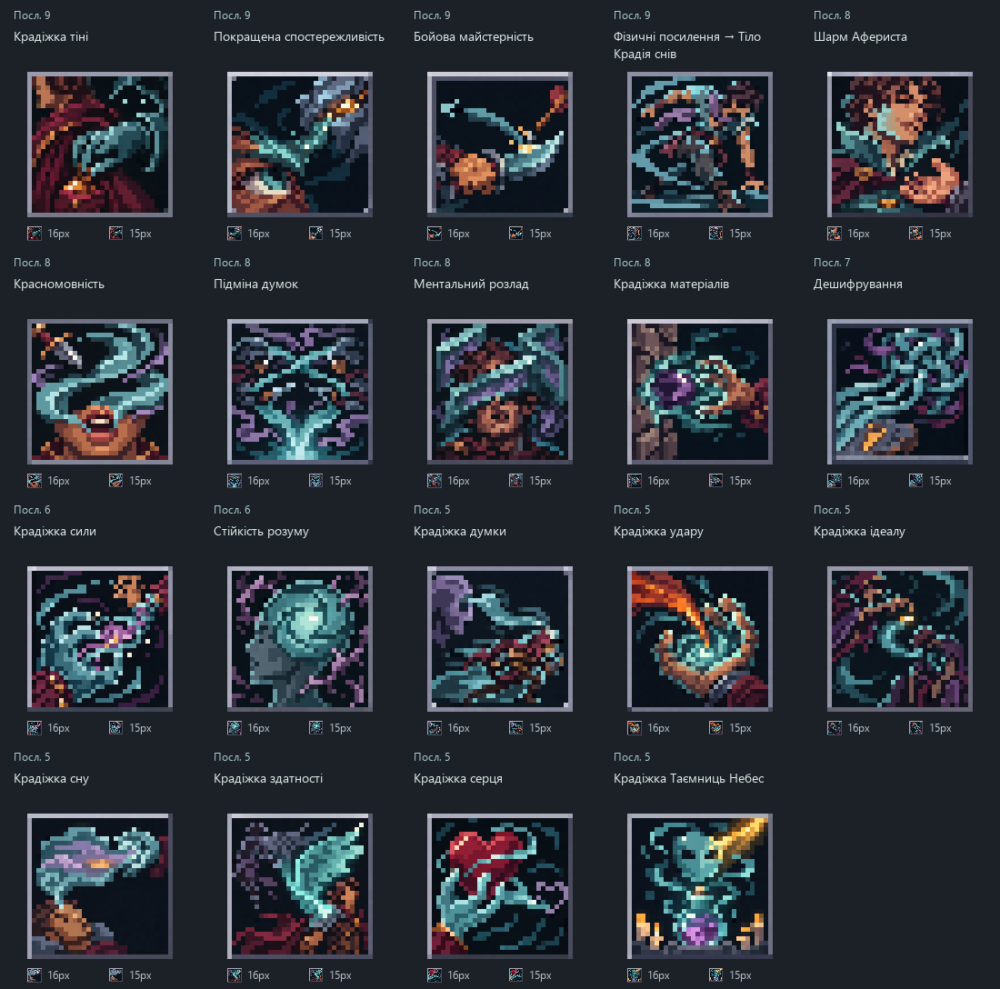

# Error — повний набір іконок

**19 окремих PNG** для всіх унікальних здібностей Error у Послідовностях 9–5. Образи звірені з поточним кодом: від кишенькової крадіжки до викрадення чужого наміру, удару, сну, здатності й життя.

Основна палітра — **#6699A1** (`102, 153, 161`) з `PathwayBranding.liquidOf("Error")`: приглушений синьо-бірюзовий, темні нафтово-сині тіні та світлі бірюзові осередки. Вона відрізняється від яскравої крижаної палітри Door. Другорядні відтінки пояснюють конкретну силу: бурштинові коштовності й прагнення, бронза шкіри, сланцева сталь, бордовий сердечний осередок, бузкові сни й хибні думки, теплий жар украденого удару.

Чіткі піксельні кластери, темне поле й спільна тонка срібляста рамка продовжують стиль готових наборів. Зображення показує предмет крадіжки та спосіб дії: річ із кишені, матеріал крізь стіну, чужа магічна сила, сон чи повсякденна здатність. Годинник або монокль не підміняють усі сили одним символом.

Створено вбудованим **image_gen**, окремим викликом для кожної іконки. [Повні промпти](prompts.json), [список файлів і концепцій](manifest.json). Великі результати — у `source/`; PNG для UI зменшено nearest-neighbor до 32×32. [Огляд 15×15 та 16×16](ui-sizes.png).

## Файли й концепції

| Посл. | Здібність | Образ | PNG 32×32 |
|---|---|---|---|
| 9 | Крадіжка тіні | Рука з темряви за спиною цілі дістає коштовність із кишені. | [error_shadow_theft.png](../../../mod/src/client/resources/assets/mysteries_above/textures/gui/sprites/ability/error_shadow_theft.png) |
| 9 | Покращена спостережливість | Уважне око відчуває коштовну жилу за каменем за напрямком світлого пилу. | [error_observation.png](../../../mod/src/client/resources/assets/mysteries_above/textures/gui/sprites/ability/error_observation.png) |
| 9 | Бойова майстерність | Короткий клинок відхиляє стрілу, залишаючи світлий слід точного парирування. | [error_combat_proficiency.png](../../../mod/src/client/resources/assets/mysteries_above/textures/gui/sprites/ability/error_combat_proficiency.png) |
| 9 | Фізичні посилення → Тіло Крадія снів | Спритна постать робить низький бічний крок; світло підкреслює рух м’язів. | [error_physique.png](../../../mod/src/client/resources/assets/mysteries_above/textures/gui/sprites/ability/error_physique.png) |
| 8 | Шарм Афериста | Спокійна усмішка й розслаблена чужа рука показують довіру, що виникає сама. | [error_swindler_charm.png](../../../mod/src/client/resources/assets/mysteries_above/textures/gui/sprites/ability/error_swindler_charm.png) |
| 8 | Красномовність | Світлі хвилі голосу змушують ворожий клинок опуститися. | [error_eloquence.png](../../../mod/src/client/resources/assets/mysteries_above/textures/gui/sprites/ability/error_eloquence.png) |
| 8 | Підміна думок | Роздвоєна хвиля хибної уваги повертає двох ворогів один проти одного. | [error_thought_misdirection.png](../../../mod/src/client/resources/assets/mysteries_above/textures/gui/sprites/ability/error_thought_misdirection.png) |
| 8 | Ментальний розлад | Навколо голови розходяться несумісні площини фальшивих стін. | [error_mental_disruption.png](../../../mod/src/client/resources/assets/mysteries_above/textures/gui/sprites/ability/error_mental_disruption.png) |
| 8 | Крадіжка матеріалів | Духовний матеріал проходить крізь кам’яну стіну до простягнутих пальців. | [error_material_theft.png](../../../mod/src/client/resources/assets/mysteries_above/textures/gui/sprites/ability/error_material_theft.png) |
| 7 | Дешифрування | Вузол прихованих слідів розплутується в чіткі світлі нитки над каменем. | [error_decryption.png](../../../mod/src/client/resources/assets/mysteries_above/textures/gui/sprites/ability/error_decryption.png) |
| 6 | Крадіжка сили | Сформований магічний заряд відривається від чужої долоні й переходить до крадія. | [error_power_theft.png](../../../mod/src/client/resources/assets/mysteries_above/textures/gui/sprites/ability/error_power_theft.png) |
| 6 | Стійкість розуму | Міцне світле ядро розуму лишається цілим, відкидаючи темні тріщини. | [error_mental_fortitude.png](../../../mod/src/client/resources/assets/mysteries_above/textures/gui/sprites/ability/error_mental_fortitude.png) |
| 5 | Крадіжка думки | Нитка наміру залишає спорожнілу голову й змушує крадія кинутися вперед. | [error_conceptual_thought.png](../../../mod/src/client/resources/assets/mysteries_above/textures/gui/sprites/ability/error_conceptual_thought.png) |
| 5 | Крадіжка удару | Ворожий удар згортається всередину долоні й стає зарядом для відповіді. | [error_conceptual_attack.png](../../../mod/src/client/resources/assets/mysteries_above/textures/gui/sprites/ability/error_conceptual_attack.png) |
| 5 | Крадіжка ідеалу | Тепла іскра прагнення виходить із грудей, а постать без неї схиляється. | [error_conceptual_ideal.png](../../../mod/src/client/resources/assets/mysteries_above/textures/gui/sprites/ability/error_conceptual_ideal.png) |
| 5 | Крадіжка сну | Сон витягується з голови на подушці та зберігається в руці крадія. | [error_conceptual_dream.png](../../../mod/src/client/resources/assets/mysteries_above/textures/gui/sprites/ability/error_conceptual_dream.png) |
| 5 | Крадіжка здатності | Примарне крило переходить від цілі до крадія як символ забраного польоту. | [error_conceptual_capacity.png](../../../mod/src/client/resources/assets/mysteries_above/textures/gui/sprites/ability/error_conceptual_capacity.png) |
| 5 | Крадіжка серця | Червоне серце переходить під світлий хват крадія; біля власника лишається порожній відбиток. | [error_conceptual_heart.png](../../../mod/src/client/resources/assets/mysteries_above/textures/gui/sprites/ability/error_conceptual_heart.png) |
| 5 | Крадіжка Таємниць Небес | Зілля на вівтарі й запозичене небесне світло надають чужій личині прийняття. | [error_theft_of_heavenly_secrets.png](../../../mod/src/client/resources/assets/mysteries_above/textures/gui/sprites/ability/error_theft_of_heavenly_secrets.png) |

Сили Послідовності 5 `error_conceptual_*` — шість окремих здібностей із власними PNG: думка, удар, ідеал, сон, здатність і серце. «Крадіжка сили» забирає здібність Потойбічного, а «Крадіжка здатності» — політ, ходу або голос; іконка останньої показує примарне крило як символ переданого польоту. Червоне серце позначає перенесення запасу здоров’я без кривавого ушкодження.

У «Крадіжці Таємниць Небес» зображені чуже зілля, чотири свічки й запозичене небесне прийняття. Це актуальний ритуал видавання себе за послідовника іншого шляху. Він тимчасово надає чужі початкові сили й ритуальну магію; такі позичені здібності використовують уже наявні іконки або піктограми, а не додаткові постійні сили Error.

Фізичне посилення повторюється на Послідовностях 9, 8, 6 та 5 під однією identity `error_physique`: одна іконка відображає розвиток тіла. Тому 22 входження в ростері дають 19 унікальних зображень.

## Інтеграція

Використано наявний GUI sprite atlas і `BookAbilityIcons`: книгу, колесо, картку перемикання й обидва HUD. «Бойова майстерність» (`common_combat_proficiency`) має окремий бірюзовий PNG для Error, теплий варіант Justiciar збережений, а WhiteTower використовує попередню піктограму. Механіки, ідентифікатори здібностей, режими й мережевий протокол не змінювались. Нових завантажувачів або залежностей немає.

Кант рамки має товщину один GUI-піксель у книзі (15×15) та колесі (16×16). Оглядові зображення не використовуються модом як атлас.

## Перевірка

`./gradlew.bat :mod:test --tests me.vangoo.mysteries.client.render.BookArtTest :mod:runClientGameTest -Ponly=Icons`

17.11.2026 успішно завершились **11/11 юніт-тестів та клієнтський ігровий тест**. Перевірено реєстрацію, розмір 32×32, унікальність PNG, повне покриття Error 19/19, шість окремих концептуальних крадіжок і збереження варіантів спільних здібностей для інших Pathways. Ігровий тест також повторно пройшов Death, Justiciar, Sun, Fool, Door і зразок Tyrant.

У реальному Minecraft 26.2 (OpenGL, GUI 2, 854×480) переглянуто всі 19 іконок у книзі й колесі. У `in-game/` збережено 19 знімків книги та 19 колеса: [перша сторінка колеса](in-game/wheel-error_shadow_theft.png), [друга сторінка](in-game/wheel-error_conceptual_heart.png), [бойова майстерність у книзі](in-game/book-common_combat_proficiency.png), [усі іконки в деталях книги](book-details.png).

Написи поряд зі спрайтами належать UI; самі PNG не містять тексту. GUI 3+ та Vulkan цим запуском не перевірялись.

