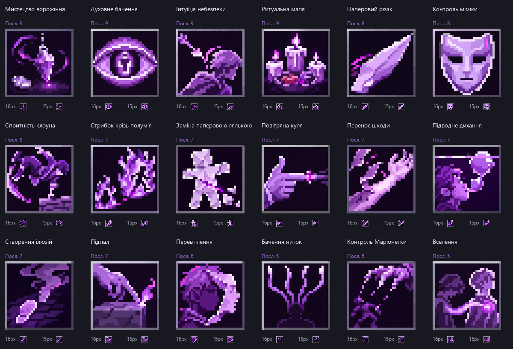

# Fool — повний набір іконок

**18 окремих PNG**, по одному на кожну наявну здібність Fool у Послідовностях 9–5. Схвалена паперова заміна збережена; решта 17 створені в тому самому стилі вбудованим `image_gen`.

Палітра спирається на `PathwayBranding.liquidOf("Fool")`: **#A26ED7**. Лавандові та перламутрові висвітлення, глибокі фіолетові тіні, невеликі магентові осередки магії. Кожна здібність має свій предмет і композицію. Рамка відповідає схваленим зразкам; у UI її кант залишається завтовшки один GUI-піксель.

Великі оригінали лежать у `source/`, схвалений оригінал паперової заміни — у [`../source/fool_paper_substitution.png`](../source/fool_paper_substitution.png). Робочі іконки — 32×32, зменшені nearest-neighbor; усі файли підключені до наявного GUI sprite atlas. [Повні промпти](prompts.json), [список файлів](manifest.json), [перевірка малих розмірів](ui-sizes.png).

Ритуальна магія (`common_ritual_magic`) та підпал (`door_burning`) спільні з іншими шляхами. Для них створені `fool_ritual_magic.png` і `fool_burning.png`; наявний рендерер вибирає ці варіанти лише тоді, коли поточний Pathway — Fool. Інші шляхи не отримують фіолетових версій цих сил; для Door підпал має власну бірюзову іконку.

Іконки використовуються в Ability Wheel, Ability Book, картці перемикання колеса та обох HUD. Механіка здібностей, їхні identity та мережевий протокол не змінювалися.

## Файли

| Посл. | Здібність | PNG 32×32 |
|---|---|---|
| 9 | Мистецтво ворожіння | [fool_divination_arts.png](../../../mod/src/client/resources/assets/mysteries_above/textures/gui/sprites/ability/fool_divination_arts.png) |
| 9 | Духовне бачення | [fool_spirit_vision.png](../../../mod/src/client/resources/assets/mysteries_above/textures/gui/sprites/ability/fool_spirit_vision.png) |
| 9 | Інтуїція небезпеки | [fool_danger_intuition.png](../../../mod/src/client/resources/assets/mysteries_above/textures/gui/sprites/ability/fool_danger_intuition.png) |
| 9 | Ритуальна магія | [fool_ritual_magic.png](../../../mod/src/client/resources/assets/mysteries_above/textures/gui/sprites/ability/fool_ritual_magic.png) |
| 8 | Паперовий різак | [fool_paper_cutter.png](../../../mod/src/client/resources/assets/mysteries_above/textures/gui/sprites/ability/fool_paper_cutter.png) |
| 8 | Контроль міміки | [fool_expression_control.png](../../../mod/src/client/resources/assets/mysteries_above/textures/gui/sprites/ability/fool_expression_control.png) |
| 8 | Спритність клоуна | [fool_agility.png](../../../mod/src/client/resources/assets/mysteries_above/textures/gui/sprites/ability/fool_agility.png) |
| 7 | Стрибок крізь полум'я | [fool_flame_jump.png](../../../mod/src/client/resources/assets/mysteries_above/textures/gui/sprites/ability/fool_flame_jump.png) |
| 7 | Заміна паперовою лялькою | [fool_paper_substitution.png](../../../mod/src/client/resources/assets/mysteries_above/textures/gui/sprites/ability/fool_paper_substitution.png) |
| 7 | Повітряна куля | [fool_air_bullet.png](../../../mod/src/client/resources/assets/mysteries_above/textures/gui/sprites/ability/fool_air_bullet.png) |
| 7 | Перенос шкоди | [fool_damage_transfer.png](../../../mod/src/client/resources/assets/mysteries_above/textures/gui/sprites/ability/fool_damage_transfer.png) |
| 7 | Підводне дихання | [fool_aquatic_breath.png](../../../mod/src/client/resources/assets/mysteries_above/textures/gui/sprites/ability/fool_aquatic_breath.png) |
| 7 | Створення ілюзій | [fool_illusion_creation.png](../../../mod/src/client/resources/assets/mysteries_above/textures/gui/sprites/ability/fool_illusion_creation.png) |
| 7 | Підпал | [fool_burning.png](../../../mod/src/client/resources/assets/mysteries_above/textures/gui/sprites/ability/fool_burning.png) |
| 6 | Перевтілення | [fool_shapeshifting.png](../../../mod/src/client/resources/assets/mysteries_above/textures/gui/sprites/ability/fool_shapeshifting.png) |
| 5 | Бачення ниток | [fool_thread_sight.png](../../../mod/src/client/resources/assets/mysteries_above/textures/gui/sprites/ability/fool_thread_sight.png) |
| 5 | Контроль Маріонетки | [fool_marionettist_control.png](../../../mod/src/client/resources/assets/mysteries_above/textures/gui/sprites/ability/fool_marionettist_control.png) |
| 5 | Вселення | [fool_marionette_possession.png](../../../mod/src/client/resources/assets/mysteries_above/textures/gui/sprites/ability/fool_marionette_possession.png) |

## Перевірка

`./gradlew.bat :mod:test --tests me.vangoo.mysteries.client.render.BookArtTest :mod:runClientGameTest -Ponly=Icons`

Усі шість юніт-тестів `BookArtTest` та ігровий тест пройшли. Перевірено відповідність зареєстрованим здібностям, окремі PNG 32×32, унікальність зображень, повноту 18/18 та відсутність фіолетових варіантів спільних сил в інших Pathways. Реальний клієнт Minecraft 26.2 (OpenGL, GUI 2, 854×480) показав усі 18 іконок у колесі та книзі. Збережено 18 скриншотів колеса й 18 книги в `in-game/`. Розміри — 16×16 і 15×15 GUI-пікселів відповідно.

[Усі іконки в деталях книги](book-details.png), [перша сторінка колеса](in-game/0010_icons-wheel-common_ritual_magic.png), [друга сторінка колеса](in-game/0036_icons-wheel-fool_marionettist_control.png).

Статичні огляди `preview.png`, `ui-sizes.png` та `book-details.png` призначені лише для перегляду; мод не використовує їх як атлас. Окремі режими здібностей не отримували додаткових іконок, оскільки це режими тієї самої сили. GUI 3+ і Vulkan цим запуском не перевірялись.
