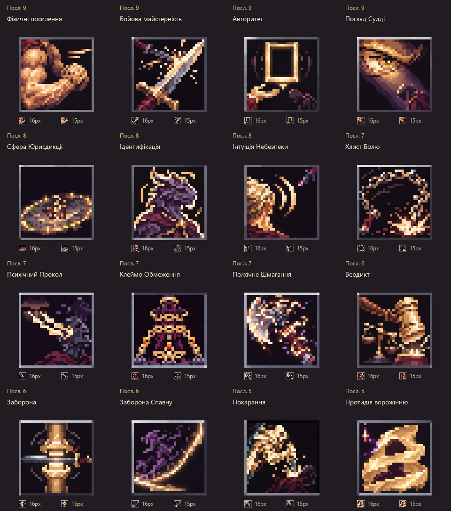

# Justiciar — повний набір іконок

**16 окремих PNG** для всіх поточних здібностей Послідовностей 9–5. Образи звірені з актуальним кодом, включно з переробленими «Авторитетом», «Клеймом Обмеження», «Хлистом Болю», «Психічним Проколом» та «Психічним Шмаганням».

Основна палітра — **#EBC38E** (`235, 195, 142`) з `PathwayBranding.liquidOf("Justiciar")`: тепле світле золото, пісочні й бронзові тіні, світла слонова кістка. Вона відрізняється від лимонно-золотого Сонця. Додаткові кольори відповідають матеріалам і механіці: холодна сланцева сталь, бордова шкіра, фіолетові духовні тіні, червоно-помаранчевий жар ланцюгів і малий бірюзовий слід телепортації.

Спільний стиль: чіткі піксельні кластери, темне поле, контрастний силует і тонка срібляста рамка. Здібності сприйняття мають різні образи: владне око, вивчений контур і передчуття загрози. Сили Послідовності 7 розрізняються предметом дії: фізичний батіг, пута на тілі, удар з очей і блискавки на холодній зброї.

Створено вбудованим **image_gen**, окремим викликом для кожної здібності. [Промпти](prompts.json), [список файлів і концепцій](manifest.json). Для «Клейма» та «Психічного Проколу» після перевірки 15–16 пікселів зроблено окреме [уточнення читабельності](refinements.json); початкові варіанти збережені в `previous/source/`. Великі джерела збережені в `source/`, робочі PNG 32×32 отримані nearest-neighbor. [Огляд при 15×15 та 16×16](ui-sizes.png).

## Файли й концепції

| Посл. | Здібність | Що зображено | PNG 32×32 |
|---|---|---|---|
| 9 | Фізичні посилення | Напружена зігнута рука й плече з теплим світлом у м’язах, сліди швидкого руху. | [justiciar_physique.png](../../../mod/src/client/resources/assets/mysteries_above/textures/gui/sprites/ability/justiciar_physique.png) |
| 9 | Бойова майстерність | Два клинки сходяться у виразному парируванні; світлий осередок контакту. | [justiciar_combat_proficiency.png](../../../mod/src/client/resources/assets/mysteries_above/textures/gui/sprites/ability/justiciar_combat_proficiency.png) |
| 9 | Авторитет | Замкнена золота рамка над долонею тисне на схилену постать. | [justiciar_authority.png](../../../mod/src/client/resources/assets/mysteries_above/textures/gui/sprites/ability/justiciar_authority.png) |
| 9 | Погляд Судді | Одне суворе золоте око схиляє чужу голову під тиском погляду. | [justiciar_arbiters_gaze.png](../../../mod/src/client/resources/assets/mysteries_above/textures/gui/sprites/ability/justiciar_arbiters_gaze.png) |
| 8 | Сфера Юрисдикції | Окреслена світлом територія закону на камені з постаттю всередині. | [justiciar_area_of_jurisdiction.png](../../../mod/src/client/resources/assets/mysteries_above/textures/gui/sprites/ability/justiciar_area_of_jurisdiction.png) |
| 8 | Ідентифікація | Чіткий світлий контур вивченої цілі між золотими осередками уваги. | [justiciar_recognition.png](../../../mod/src/client/resources/assets/mysteries_above/textures/gui/sprites/ability/justiciar_recognition.png) |
| 8 | Інтуїція Небезпеки | Золоті хвилі передчуття біля вуха помічають клинок позаду. | [justiciar_intuition.png](../../../mod/src/client/resources/assets/mysteries_above/textures/gui/sprites/ability/justiciar_intuition.png) |
| 7 | Хлист Болю | Батіг із залізних ланок розгортається дугою та б’є світлим ударом. | [justiciar_whip_of_pain.png](../../../mod/src/client/resources/assets/mysteries_above/textures/gui/sprites/ability/justiciar_whip_of_pain.png) |
| 7 | Психічний Прокол | Два розряди з очей пробивають голову та зсувають блідий духовний двійник. | [justiciar_psychic_piercing.png](../../../mod/src/client/resources/assets/mysteries_above/textures/gui/sprites/ability/justiciar_psychic_piercing.png) |
| 7 | Клеймо Обмеження | Три ланцюги сковують тіло й ноги; залізний обруч замикається на голові. | [justiciar_brand_of_restraint.png](../../../mod/src/client/resources/assets/mysteries_above/textures/gui/sprites/ability/justiciar_brand_of_restraint.png) |
| 7 | Психічне Шмагання | Сталеве лезо сокири вкривають ілюзорні блискавки для удару по духу. | [justiciar_psychic_lashing.png](../../../mod/src/client/resources/assets/mysteries_above/textures/gui/sprites/ability/justiciar_psychic_lashing.png) |
| 6 | Вердикт | Суддівський молот опускається над терезами як символ винесення різних вироків. | [justiciar_verdict.png](../../../mod/src/client/resources/assets/mysteries_above/textures/gui/sprites/ability/justiciar_verdict.png) |
| 6 | Заборона | Закон замикає світлий затискач навколо клинка, припиняючи заборонену дію. | [justiciar_power_prohibition.png](../../../mod/src/client/resources/assets/mysteries_above/textures/gui/sprites/ability/justiciar_power_prohibition.png) |
| 6 | Заборона Спавну | Нечисть розпадається на темні уламки біля світлої межі забороненої території. | [justiciar_spawn_prohibition.png](../../../mod/src/client/resources/assets/mysteries_above/textures/gui/sprites/ability/justiciar_spawn_prohibition.png) |
| 5 | Покарання | Силует судді виникає позаду порушника для неминучого карального удару. | [justiciar_punishment.png](../../../mod/src/client/resources/assets/mysteries_above/textures/gui/sprites/ability/justiciar_punishment.png) |
| 5 | Протидія ворожінню | Непрозора світла завіса приховує постать і відхиляє фіолетовий пошуковий промінь. | [justiciar_anti_divination.png](../../../mod/src/client/resources/assets/mysteries_above/textures/gui/sprites/ability/justiciar_anti_divination.png) |

Для багаторежимних сил використано один узагальнений образ або представницький режим: «Вердикт» — символ винесення різних вироків; «Заборона» — припинення використання зброї; «Покарання» — автоматичний удар із телепортації. Режими, що обираються предметом у руці, зберігають свою механіку й не отримують дубльованих іконок.

## Інтеграція

Іконки використовують наявний GUI sprite atlas та `BookAbilityIcons`: книгу, колесо, картку перемикання й обидва HUD. «Бойова майстерність» (`common_combat_proficiency`) та «Протидія ворожінню» (`door_anti_divination`) отримали власні PNG, які вибираються лише для Justiciar. Door зберігає свою бірюзову протидію ворожінню, Error має [власну бірюзову версію](../error/README.md), а WhiteTower — попередню піктограму бойової майстерності. Нових завантажувачів, залежностей, змін мережевого протоколу або механік не додано.

Один GUI-піксель рамки залишається видимим у малих розмірах. Оглядові картинки не використовуються модом як атлас.

## Перевірка

`./gradlew.bat :mod:test --tests me.vangoo.mysteries.client.render.BookArtTest :mod:runClientGameTest -Ponly=Icons`

17.11.2026 завершились успішно **9/9 юніт-тестів та клієнтський ігровий тест**. Перевірено реєстрацію, розміри 32×32, унікальність спрайтів, покриття Justiciar 16/16 і збереження палітр спільних здібностей для Door, Error та WhiteTower. Ігровий тест також повторно пройшов набори Sun, Fool, Door і зразок Tyrant.

У реальному Minecraft 26.2 (OpenGL, GUI 2, 854×480) переглянуто всі 16 іконок у книзі та колесі. У `in-game/` збережено 16 знімків книги й 16 колеса. [Усі іконки в деталях книги](book-details.png), [перша сторінка колеса](in-game/wheel-justiciar_brand_of_restraint.png), [друга сторінка](in-game/wheel-justiciar_punishment.png), [тепла протидія ворожінню в книзі](in-game/book-door_anti_divination.png).

Написи поряд зі спрайтами належать UI; самі іконки не містять тексту. GUI 3+ та Vulkan цим запуском не перевірялись.

