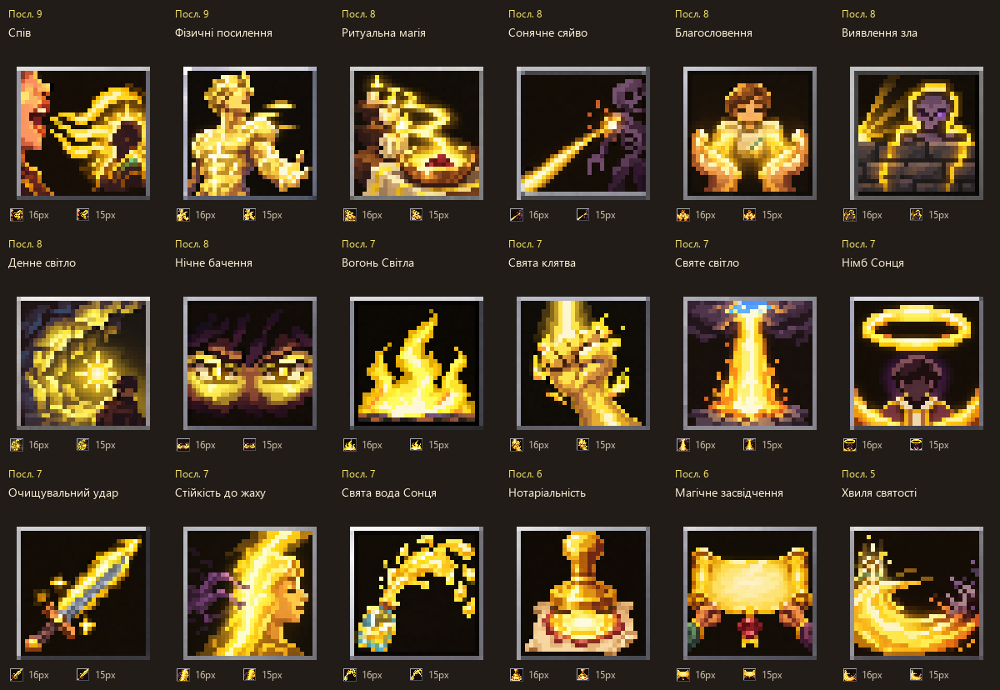

# Sun — повний набір іконок

**18 окремих PNG** для всіх наявних здібностей шляху Сонця в Послідовностях 9–5. Концепції звірені з поточною реалізацією здібностей, включно з пасивними силами та оновленим «Магічним засвідченням».

Головна палітра — **#FBE86B** (`251, 232, 107`) з `PathwayBranding.liquidOf("Sun")`: лимонне золото, теплі перламутрові осередки та майже чорне поле. Додаткові кольори пояснюють матеріали й дію: мідь та жар у полум’ї, бронза шкіри, нефрит зцілення, бірюзове скло, сланцева сталь і приглушений фіолетовий нечисті та тіней. Спільна тонка срібляста рамка зберігає стиль Fool і Door.

Промінь, стовп із неба, полум’я на землі, німб і хвиля мають різні композиції. Ритуальна магія отримала власний сонячний PNG; її варіант обирається лише для Sun, а Fool та WhiteTower зберігають свої іконки.

Зображення створені по одному вбудованим **image_gen**: 16 нових та 2 редагування попередніх зразків зі збереженням їхніх композицій. [Повні промпти й режими генерації](prompts.json), [список файлів](manifest.json). Після огляду малих розмірів для чотирьох нових іконок додатково уточнено лимонно-золоті освітлені площини: [промпти уточнення палітри](palette-refinements.json), попередні варіанти у `previous/source/`. Великі остаточні результати — у `source/`, PNG для UI зменшені nearest-neighbor до 32×32. Попередні два UI-зразки збережені в `previous/runtime/`, їхні початкові великі зображення — у `../source/`.

## Здібності та файли

| Посл. | Здібність | Образ | PNG 32×32 |
|---|---|---|---|
| 9 | Спів | Золоті хвилі голосу від співака до слухача; нефритовий акцент відновлення. | [sun_singing.png](../../../mod/src/client/resources/assets/mysteries_above/textures/gui/sprites/ability/sun_singing.png) |
| 9 | Фізичні посилення | Світло в м’язах торса й руки, бронзові площини та слід прискореного руху. | [sun_physical_enhancement.png](../../../mod/src/client/resources/assets/mysteries_above/textures/gui/sprites/ability/sun_physical_enhancement.png) |
| 8 | Ритуальна магія | Косий вівтар із мідною чашею приношення й трьома свічками. | [sun_ritual_magic.png](../../../mod/src/client/resources/assets/mysteries_above/textures/gui/sprites/ability/sun_ritual_magic.png) |
| 8 | Сонячне сяйво | Вузький спрямований промінь влучає в темну нежить; гарячий осередок удару. | [sun_sunshine.png](../../../mod/src/client/resources/assets/mysteries_above/textures/gui/sprites/ability/sun_sunshine.png) |
| 8 | Благословення | Розкриті долоні оберігають союзника золотим світлом; малий нефритовий акцент зцілення. | [sun_blessing.png](../../../mod/src/client/resources/assets/mysteries_above/textures/gui/sprites/ability/sun_blessing.png) |
| 8 | Виявлення зла | Золотий контур скелетної постаті видно крізь кам’яну перешкоду. | [sun_evil_detection.png](../../../mod/src/client/resources/assets/mysteries_above/textures/gui/sprites/ability/sun_evil_detection.png) |
| 8 | Денне світло | Мініатюрне сонце над плечем освітлює темний кам’яний закуток. | [sun_daytime.png](../../../mod/src/client/resources/assets/mysteries_above/textures/gui/sprites/ability/sun_daytime.png) |
| 8 | Нічне бачення | Два золоті сонця в зіницях, бронзова шкіра й синьо-фіолетові тіні. | [sun_night_vision.png](../../../mod/src/client/resources/assets/mysteries_above/textures/gui/sprites/ability/sun_night_vision.png) |
| 7 | Вогонь Світла | Три язики стаціонарного святого полум’я на камені; мідь та помаранчевий жар. | [sun_fire_of_light.png](../../../mod/src/client/resources/assets/mysteries_above/textures/gui/sprites/ability/sun_fire_of_light.png) |
| 7 | Свята клятва | Осяяний променем кулак із полум’ям: посилені палаючі удари та видимий заклинач. | [sun_holy_oath.png](../../../mod/src/client/resources/assets/mysteries_above/textures/gui/sprites/ability/sun_holy_oath.png) |
| 7 | Святе світло | Стовп світла падає з відкритого неба на камінь; фіолетові хмари й мідний удар. | [sun_holy_light_summoning.png](../../../mod/src/client/resources/assets/mysteries_above/textures/gui/sprites/ability/sun_holy_light_summoning.png) |
| 7 | Німб Сонця | Еліптичний німб над головою та край очисного імпульсу внизу. | [sun_halo.png](../../../mod/src/client/resources/assets/mysteries_above/textures/gui/sprites/ability/sun_halo.png) |
| 7 | Очищувальний удар | Сталевий меч із золотим освяченим лезом і зарядами біля гарди. | [sun_cleave_of_purification.png](../../../mod/src/client/resources/assets/mysteries_above/textures/gui/sprites/ability/sun_cleave_of_purification.png) |
| 7 | Стійкість до жаху | Спокійний профіль і золота завіса розчиняють фіолетову примарну лапу. | [sun_resistance_to_horror.png](../../../mod/src/client/resources/assets/mysteries_above/textures/gui/sprites/ability/sun_resistance_to_horror.png) |
| 7 | Свята вода Сонця | Скляна пляшка виливає дугу золотої святої води; бірюзові грані скла. | [sun_holy_water.png](../../../mod/src/client/resources/assets/mysteries_above/textures/gui/sprites/ability/sun_holy_water.png) |
| 6 | Нотаріальність | Золотий штамп засвідчує чистий аркуш; бордовий край воскової печатки. | [sun_notarization.png](../../../mod/src/client/resources/assets/mysteries_above/textures/gui/sprites/ability/sun_notarization.png) |
| 6 | Магічне засвідчення | Двоє тримають чистий сувій із печаткою: взаємний мир або боргова клятва. | [sun_contract.png](../../../mod/src/client/resources/assets/mysteries_above/textures/gui/sprites/ability/sun_contract.png) |
| 5 | Хвиля святості | Широкий золотий фронт хвилі лікує союзника й руйнує нечисть; нефрит і фіолетові уламки. | [sun_holy_wave.png](../../../mod/src/client/resources/assets/mysteries_above/textures/gui/sprites/ability/sun_holy_wave.png) |

## Інтеграція та перевірка

Використано наявний GUI sprite atlas і `BookAbilityIcons`. Іконки доступні книзі, колесу, його картці перемикання й обом HUD через спільний рендерер. Завантажувачів, залежностей і змін механіки здібностей не додано. Один GUI-піксель рамки залишається видимим у книзі (15×15) та колесі (16×16).

[Огляд реальних розмірів](ui-sizes.png), [деталі всіх іконок у книзі](book-details.png). Оглядові картинки слугують лише для перевірки; мод використовує окремі PNG.

Перевірка: `./gradlew.bat :mod:test --tests me.vangoo.mysteries.client.render.BookArtTest :mod:runClientGameTest -Ponly=Icons`.

17.11.2026 перевірка завершилась успішно: **8/8 юніт-тестів** та клієнтський ігровий тест. Перевірено наявність і розмір усіх PNG, унікальність, покриття Sun 18/18, збереження варіантів Fool і Door та вибір сонячної ритуальної магії лише для Sun.

У реальному Minecraft 26.2 (OpenGL, GUI 2, вікно 854×480) переглянуто всі 18 іконок у книзі та колесі. У `in-game/` збережено 18 знімків книги та 18 колеса: [перша сторінка колеса](in-game/wheel-sun_singing.png), [друга сторінка](in-game/wheel-sun_notarization.png), [ритуальна магія в книзі](in-game/book-common_ritual_magic.png). Написи поруч зі спрайтами належать UI; самі іконки не містять тексту.

GUI 3+ та Vulkan цим запуском не перевірялись.

