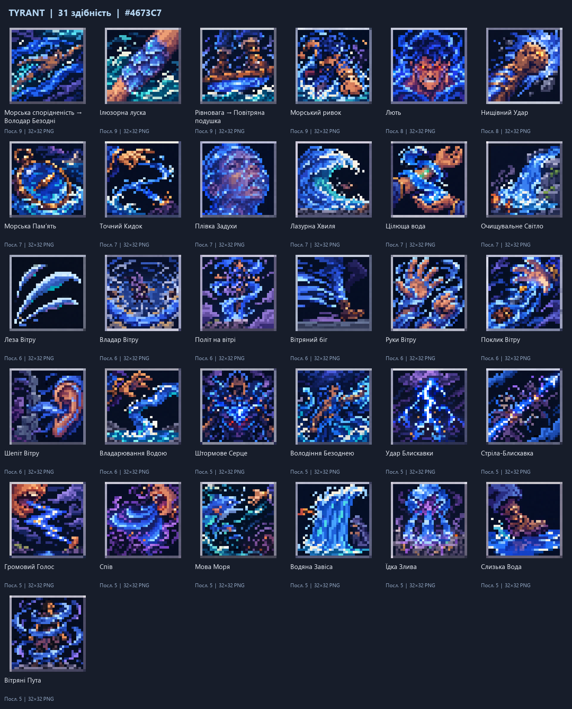

# Tyrant — повний набір іконок

**31 окремий PNG** для всіх унікальних здібностей Tyrant у Послідовностях 9–5. Концепції звірені з актуальним кодом: море, шторм, вітер, фізична міць, навігація та голос.

Основна палітра — **#4673C7** (`70, 115, 199`) з `PathwayBranding.liquidOf("Tyrant")`: насичений океанічний синій, індигові тіні, блідо-сині осередки та невеликі сріблясто-білі краї. Вода отримує другорядні бірюзові грані й піну; блискавка — срібло та теплі іскри; лікування — малий нефритовий відтінок; духовний голос і корозія — бузкові та сливові тіні. Шкіра, палуба, взуття й компас мають природні бронзові, коричневі та латунні акценти. Синій залишається головним кольором магії.

Водні й вітряні сили мають різні силуети та дію: рухома хвиля, вода навколо голови, захисна стіна, керований струмінь, злива, плоский слизький розлив; політ, біг, стиснені долоні, хват вихору й збирання предметів. Голосове послання одному адресатові відрізняється від духовного співу проти ворогів.

Створено вбудованим **image_gen**, окремим викликом для кожної іконки: 30 нових зображень та колірне уточнення затверджених «Лез Вітру» зі збереженням трьох лез і композиції. [Повні промпти](prompts.json), [список файлів і концепцій](manifest.json). Великі результати — в `source/`, PNG для UI зменшені nearest-neighbor до 32×32. Старий UI-зразок «Лез Вітру» збережено в `previous/runtime/`, його початкове велике джерело — у `../source/tyrant_windblades.png`.

Реальні розміри після збільшення UI: **24×24** у колесі, списках книги й обох HUD; **32×32** у деталях вибраної здібності. [Огляд 24×24 та 32×32](ui-sizes.png). Спільна срібляста рамка має товщину один GUI-піксель.

## Файли й концепції

| Посл. | Здібність | Образ | PNG 32×32 |
|---|---|---|---|
| 9 | Морська спорідненість → Володар Безодні | Сильна постать пливе під водою, обтікаючи плечима глибоку течію. | [tyrant_physique.png](../../../mod/src/client/resources/assets/mysteries_above/textures/gui/sprites/ability/tyrant_physique.png) |
| 9 | Ілюзорна луска | Під водою на шкірі проявляються великі міцні риб’ячі луски. | [tyrant_illusory_scales.png](../../../mod/src/client/resources/assets/mysteries_above/textures/gui/sprites/ability/tyrant_illusory_scales.png) |
| 9 | Рівновага → Повітряна подушка | Дві стійкі стопи над хиткою палубою та подушкою стисненого повітря. | [tyrant_stance.png](../../../mod/src/client/resources/assets/mysteries_above/textures/gui/sprites/ability/tyrant_stance.png) |
| 9 | Морський ривок | Постать виривається вперед із водяного сплеску, відкидаючи ворога. | [tyrant_sea_lunge.png](../../../mod/src/client/resources/assets/mysteries_above/textures/gui/sprites/ability/tyrant_sea_lunge.png) |
| 8 | Лють | Палаючий погляд і напружені плечі в синьому вихорі гніву. | [tyrant_wrath.png](../../../mod/src/client/resources/assets/mysteries_above/textures/gui/sprites/ability/tyrant_wrath.png) |
| 8 | Нищівний Удар | Один заряджений кулак розриває повітря фронтальним ударом. | [tyrant_raging_blow.png](../../../mod/src/client/resources/assets/mysteries_above/textures/gui/sprites/ability/tyrant_raging_blow.png) |
| 7 | Морська Пам’ять | Заряджений компас пам’ятає берег і веде стрілку до нього. | [tyrant_sea_memory.png](../../../mod/src/client/resources/assets/mysteries_above/textures/gui/sprites/ability/tyrant_sea_memory.png) |
| 7 | Точний Кидок | Кинутий водяний болт вивертає коротку точну дугу до однієї цілі. | [tyrant_precise_throw.png](../../../mod/src/client/resources/assets/mysteries_above/textures/gui/sprites/ability/tyrant_precise_throw.png) |
| 7 | Плівка Задухи | Тонка вода щільно огортає голову, затримуючи останню бульбашку біля рота. | [tyrant_water_film.png](../../../mod/src/client/resources/assets/mysteries_above/textures/gui/sprites/ability/tyrant_water_film.png) |
| 7 | Лазурна Хвиля | Високий водяний гребінь котиться вздовж землі й зносить темну постать. | [tyrant_azure_wave.png](../../../mod/src/client/resources/assets/mysteries_above/textures/gui/sprites/ability/tyrant_azure_wave.png) |
| 7 | Цілюща вода | Синя вода огортає руку союзника й змикає над нею світлий відновлювальний потік. | [tyrant_restorative_water.png](../../../mod/src/client/resources/assets/mysteries_above/textures/gui/sprites/ability/tyrant_restorative_water.png) |
| 7 | Очищувальне Світло | Чиста синя вода змиває гарячі язики полум’я з поверхні. | [tyrant_cleansing_light.png](../../../mod/src/client/resources/assets/mysteries_above/textures/gui/sprites/ability/tyrant_cleansing_light.png) |
| 6 | Леза Вітру | Три нерівні вигнуті леза стисненого повітря розходяться різальним віялом. | [tyrant_windblades.png](../../../mod/src/client/resources/assets/mysteries_above/textures/gui/sprites/ability/tyrant_windblades.png) |
| 6 | Владар Вітру | Кільце стисненого повітря розходиться від постаті й відкидає уламки. | [tyrant_pressure_wave.png](../../../mod/src/client/resources/assets/mysteries_above/textures/gui/sprites/ability/tyrant_pressure_wave.png) |
| 6 | Політ на вітрі | Постать підіймається над урвищем на широкій спіралі повітря. | [tyrant_wind_flight.png](../../../mod/src/client/resources/assets/mysteries_above/textures/gui/sprites/ability/tyrant_wind_flight.png) |
| 6 | Вітряний біг | Нога в швидкому кроці тягне за собою довгі сині смуги вітру. | [tyrant_wind_sprint.png](../../../mod/src/client/resources/assets/mysteries_above/textures/gui/sprites/ability/tyrant_wind_sprint.png) |
| 6 | Руки Вітру | Дві долоні охоплені щільними синіми обручами повітря для ближніх ударів. | [tyrant_wind_imbued_hands.png](../../../mod/src/client/resources/assets/mysteries_above/textures/gui/sprites/ability/tyrant_wind_imbued_hands.png) |
| 6 | Поклик Вітру | Вихор біля долоні підхоплює з землі кілька кинутих предметів. | [tyrant_wind_pull.png](../../../mod/src/client/resources/assets/mysteries_above/textures/gui/sprites/ability/tyrant_wind_pull.png) |
| 6 | Шепіт Вітру | Велике вухо перехоплює принесений вітром відбиток далекого дихання. | [tyrant_eavesdrop.png](../../../mod/src/client/resources/assets/mysteries_above/textures/gui/sprites/ability/tyrant_eavesdrop.png) |
| 6 | Владарювання Водою | Рука піднімає й закручує струмінь із наявної води. | [tyrant_water_control.png](../../../mod/src/client/resources/assets/mysteries_above/textures/gui/sprites/ability/tyrant_water_control.png) |
| 5 | Штормове Серце | Виснажене серце спалахує синім штормом усередині грудей. | [tyrant_storm_heart.png](../../../mod/src/client/resources/assets/mysteries_above/textures/gui/sprites/ability/tyrant_storm_heart.png) |
| 5 | Володіння Безоднею | Постать під важкою товщею води захищена глибиною й сама б’є сильніше. | [tyrant_abyssal_dominion.png](../../../mod/src/client/resources/assets/mysteries_above/textures/gui/sprites/ability/tyrant_abyssal_dominion.png) |
| 5 | Удар Блискавки | Вертикальний розгалужений розряд уражає головну ціль і перескакує на сусідні. | [tyrant_lightning_strike.png](../../../mod/src/client/resources/assets/mysteries_above/textures/gui/sprites/ability/tyrant_lightning_strike.png) |
| 5 | Стріла-Блискавка | Прямий блискавичний спис наскрізь пробиває ряд темних цілей. | [tyrant_lightning_bolt_arrow.png](../../../mod/src/client/resources/assets/mysteries_above/textures/gui/sprites/ability/tyrant_lightning_bolt_arrow.png) |
| 5 | Громовий Голос | Голос-блискавка переносить послання від уст до одного далекого адресата. | [tyrant_thunder_voice.png](../../../mod/src/client/resources/assets/mysteries_above/textures/gui/sprites/ability/tyrant_thunder_voice.png) |
| 5 | Спів | Широкий духовний голос хвилями пригнічує й розладнує ворогів. | [tyrant_singing.png](../../../mod/src/client/resources/assets/mysteries_above/textures/gui/sprites/ability/tyrant_singing.png) |
| 5 | Мова Моря | Морська істота повертається на поклик і веде за собою союзну живність. | [tyrant_sea_tongue.png](../../../mod/src/client/resources/assets/mysteries_above/textures/gui/sprites/ability/tyrant_sea_tongue.png) |
| 5 | Водяна Завіса | Стіна синьої води поглинає палаючий снаряд і закриває союзника. | [tyrant_water_curtain.png](../../../mod/src/client/resources/assets/mysteries_above/textures/gui/sprites/ability/tyrant_water_curtain.png) |
| 5 | Їдка Злива | Підвішена синя сфера тріскається й обрушує їдкі краплі на землю. | [tyrant_corrosive_deluge.png](../../../mod/src/client/resources/assets/mysteries_above/textures/gui/sprites/ability/tyrant_corrosive_deluge.png) |
| 5 | Слизька Вода | Стопа з’їжджає убік по плоскому дзеркальному розливу води. | [tyrant_slick_water.png](../../../mod/src/client/resources/assets/mysteries_above/textures/gui/sprites/ability/tyrant_slick_water.png) |
| 5 | Вітряні Пута | Замкнений спіральний вихор охоплює тіло й утримує стопи на землі. | [tyrant_wind_binding.png](../../../mod/src/client/resources/assets/mysteries_above/textures/gui/sprites/ability/tyrant_wind_binding.png) |

Ростер містить 36 входжень, але 31 унікальну identity. Посилення тіла повторюється від Матроса до Океанського Співця під `tyrant_physique`. «Рівновага» та «Повітряна подушка» також розвивають одну силу `tyrant_stance`. Кожна з них має одну іконку розвитку.

Для багаторежимних сил використано спільний образ здібності: три леза віялом, піднесення на вітрі, керований струмінь води, розгалужений удар блискавки та духовний спів. Режими польоту/ковзання, насичення зброї, водяного щита/просочення і три голоси зберігають свої механіки без додаткових дубльованих іконок.

«Поклик Вітру» збирає кинуті предмети, а не ворогів. «Громовий Голос» передає приватне послання, а не вражає ціль. «Очищувальне Світло» — чиста вода, що гасить вогонь, а не святе сонячне сяйво. «Мова Моря» підкорює наявну морську живність, а не вигадує нове чудовисько.

## Інтеграція

Використано наявний GUI sprite atlas та `BookAbilityIcons`: книгу, колесо, картку перемикання та обидва HUD. Іконки додані за чинними identity, без нових завантажувачів, залежностей, змін механіки або мережевого протоколу. Оглядові картинки не використовуються модом як атлас.

## Перевірка

`./gradlew.bat :mod:test --tests me.vangoo.mysteries.client.render.BookArtTest :mod:runClientGameTest -Ponly=Icons`

17.11.2026 пройшли **12/12 юніт-тестів**: перевірено реєстрацію, розмір 32×32, унікальність пікселів, повне покриття Tyrant 31/31 та збереження іконок інших Pathways. Повторні рівні `tyrant_physique` і `tyrant_stance` використовують свої спільні іконки.

Клієнтський ігровий тест також завершився успішно: Tyrant, Error, Death, Justiciar, Sun, Fool і Door — загалом 136 окремих спрайтів та 279 знімків, включно з обома HUD, трьома оформленнями колеса й сторінками клавіш та груп.

У Minecraft 26.2 (OpenGL, GUI 2, 854×480) переглянуто всі 31 іконку в книзі та на трьох сторінках колеса. У `in-game/` збережені 31 знімок книги й 31 колеса: [сторінка 1](in-game/wheel-tyrant_physique.png), [сторінка 2](in-game/wheel-tyrant_windblades.png), [сторінка 3](in-game/wheel-tyrant_thunder_voice.png), [деталі всіх іконок у книзі](book-details.png), [багаторежимне владарювання водою](in-game/book-tyrant_water_control.png).

Написи поряд з іконками належать UI; PNG не містять тексту. GUI 3+ та Vulkan цим запуском не перевірялись.

