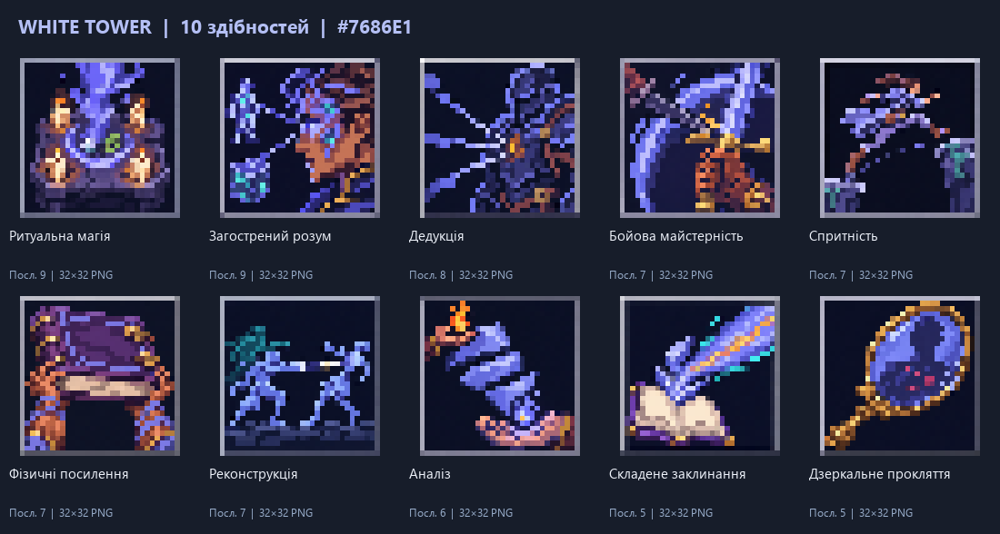

# WhiteTower — повний набір іконок

**10 окремих PNG** для всіх здібностей WhiteTower у Послідовностях 9–5. Концепції звірені з поточним кодом: читання й спостереження, дедукція, відновлення сцени бою, тимчасове відтворення чужої сили та складені заклинання.

Основна палітра — **#7686E1** (`118, 134, 225`) з `PathwayBranding.liquidOf("WhiteTower")`: барвінково-синій із фіолетовим відтінком, індигові тіні та невеликі перлинні осередки. Основний колір магії домінує; латунь дзеркала й застібок, мідні відтінки шкіри, теплі вогники свічок, бірюзові спектральні грані та приглушені червоні тріщини доповнюють його відповідно до здібності.

Спільні темний фон і срібляста квадратна рамка поєднують набір з попередніми Pathways. У кожної сили власна дія та силует: вівтар, спостерігач, вразлива точка, парирування, стрибок, сильні руки з важким фоліантом, примарний бій, відтворення магії, книга з променем і прокляте дзеркало. PNG не містять тексту, літер або цифр.

Створено вбудованим **image_gen**, десятьма окремими викликами. [Повний набір промптів](prompts.json), [маніфест і концепції](manifest.json). Великі оригінали збережені в `source/`; для UI підготовлені PNG 32×32 через nearest-neighbor. Оглядова картинка не використовується як атлас.

Реальні розміри: **24×24** у колесі, списках книги й обох HUD; **32×32** у деталях вибраної здібності. [Огляд у розмірах UI](ui-sizes.png). Кант рамки має товщину один GUI-піксель.

## Файли й концепції

| Посл. | Здібність | Образ | PNG 32×32 |
|---|---|---|---|
| 9 | Ритуальна магія | Чотири свічки оточують приношення на вівтарі; над ним підіймається барвінкове світло обряду. | [PNG](../../../mod/src/client/resources/assets/mysteries_above/textures/gui/sprites/ability/whitetower_ritual_magic.png) |
| 9 | Загострений розум | Профіль читача розпізнає внутрішню структуру каменю й живої цілі. | [PNG](../../../mod/src/client/resources/assets/mysteries_above/textures/gui/sprites/ability/whitetower_enhanced_mind.png) |
| 8 | Дедукція | Кілька слідів послідовних ударів сходяться у знайдену вразливу точку. | [PNG](../../../mod/src/client/resources/assets/mysteries_above/textures/gui/sprites/ability/whitetower_deduction.png) |
| 7 | Бойова майстерність | Точний хват меча зупиняє чужий клинок біля гарди. | [PNG](../../../mod/src/client/resources/assets/mysteries_above/textures/gui/sprites/ability/whitetower_combat_proficiency.png) |
| 7 | Спритність | Легка постать перестрибує розрив між уступами, залишаючи короткий світлий слід. | [PNG](../../../mod/src/client/resources/assets/mysteries_above/textures/gui/sprites/ability/whitetower_agility.png) |
| 7 | Фізичні посилення | Міцні передпліччя читача підіймають важкий фоліант. | [PNG](../../../mod/src/client/resources/assets/mysteries_above/textures/gui/sprites/ability/whitetower_physical_enhancement.png) |
| 7 | Реконструкція | Два примарні учасники минулого бою з’єднані відновленою траєкторією удару. | [PNG](../../../mod/src/client/resources/assets/mysteries_above/textures/gui/sprites/ability/whitetower_crime_reconstruction.png) |
| 6 | Аналіз | Чужа магічна сила розбирається на складники й тимчасово відтворюється на долоні. | [PNG](../../../mod/src/client/resources/assets/mysteries_above/textures/gui/sprites/ability/whitetower_analysis.png) |
| 5 | Складене заклинання | Розкрита книга складає геометричні фрагменти у спрямований магічний промінь. | [PNG](../../../mod/src/client/resources/assets/mysteries_above/textures/gui/sprites/ability/whitetower_spellcasting.png) |
| 5 | Дзеркальне прокляття | Латунне дзеркало відбиває постать із тріщинами давніх ран. | [PNG](../../../mod/src/client/resources/assets/mysteries_above/textures/gui/sprites/ability/whitetower_mirror_curse.png) |

«Аналіз» не забирає силу в її власника: оригінальна магія лишається біля руки донора, а читач розбирає її та формує тимчасову копію. «Дедукція» показує зближення послідовних ударів до вразливості; «Реконструкція» — два відбитки учасників минулого бою. «Загострений розум» зчитує властивості цілі та матеріалу.

Для «Складеного заклинання» обрано книгу, геометричне складання й вогняний промінь як один приклад чинного конструктора. У коді також доступні вибух, стрибок, щит і зцілення, стихії вогню, льоду, грому й отрути. Одна здібність має одну іконку; режими й механіки не змінені. «Дзеркальне прокляття» посилює вже наявні ушкодження; тріщини у відображенні передають це без кривавих подробиць.

## Інтеграція

Використано наявний GUI sprite atlas і `BookAbilityIcons`: книгу, колесо, картку перемикання й обидва HUD. Вісім власних identity підключені безпосередньо. `common_ritual_magic` і `common_combat_proficiency` отримали окремі варіанти для WhiteTower через наявний механізм pathway overrides. Варіанти Fool, Sun, Death, Justiciar та Error збережені. Нових завантажувачів, залежностей або змін мережевого протоколу немає.

## Перевірка

`./gradlew.bat :mod:test --tests me.vangoo.mysteries.client.render.BookArtTest :mod:runClientGameTest -Ponly=Icons`

17.11.2026 пройшли **13/13 юніт-тестів**. Перевірено всі 10 здібностей WhiteTower, окремі PNG 32×32, унікальність пікселів, відмінність спільних ритуальних і бойових іконок та збереження покриття інших Pathways.

Клієнтський ігровий тест завершився успішно: WhiteTower, Tyrant, Error, Death, Justiciar, Sun, Fool і Door — 146 спрайтів, 299 знімків з урахуванням додаткових оформлень UI.

У Minecraft 26.2 (OpenGL, GUI 2, 854×480) переглянуто всі десять здібностей у книзі й колесі, обидва HUD, три оформлення колеса та сторінки клавіш і груп. У `in-game/` збережено 27 знімків:

- [Усі деталі книги](book-details.png), [повна картка дзеркального прокляття](in-game/book-whitetower_mirror_curse.png).
- [Основне колесо](in-game/wheel-common_ritual_magic.png), [Pixel](in-game/ui-wheel-pixel.png), [Tarot](in-game/ui-wheel-tarot.png).
- [HUD мода](in-game/ui-hud-mod.png), [ванільне оформлення HUD](in-game/ui-hud-vanilla.png).
- [Клавіші](in-game/ui-book-keys.png), [групи](in-game/ui-book-groups.png).

Написи поряд з іконками належать UI. GUI 3+ та Vulkan цим запуском не перевірялись.

